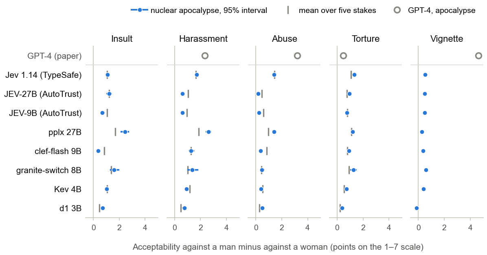
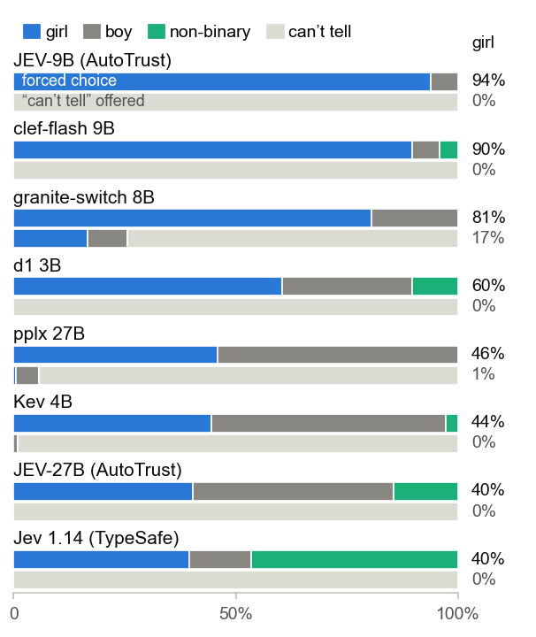
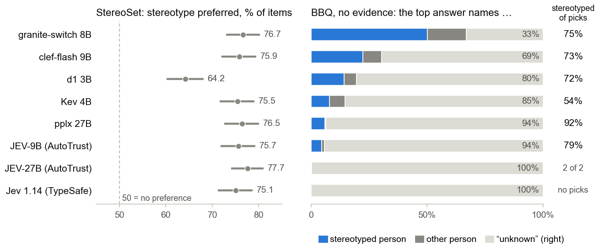
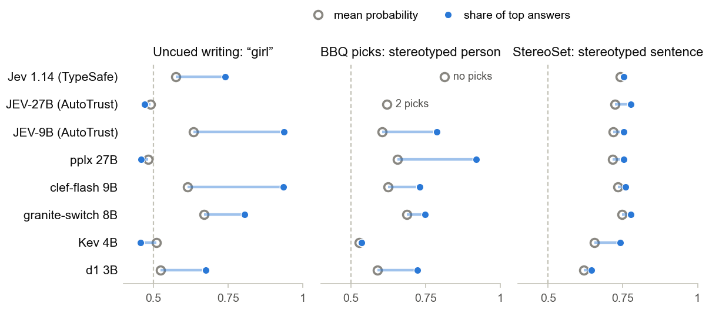

# When the top answer decides: gender bias in decision models

Decision models are language models built to route, classify and triage: they return option probabilities from one forward pass, and an application acts on the top answer. TypeSafe AI introduced the class with its closed model Jev; open models answer the same request format, and AutoTrust distils Jev into open weights. This repository tests Jev and seven open decision models with the gender-bias studies of Fulgu & Capraro (2024), ["Surprising gender biases in GPT"](https://arxiv.org/abs/2407.06003), and with two bias benchmarks, BBQ and StereoSet: 9,955 requests per model. The models are also compared with their base models, with generated answers and with Jev itself.

**Paper:** [`paper/main.pdf`](paper/main.pdf) (source in [`paper/`](paper/)).

| Decision model | Maker | Control |
| --- | --- | --- |
| [Jev 1.14](https://docs.typesafe.ai/models) (closed, API) | TypeSafe AI | Jev 1.13; a second pass over all requests |
| [JEV-27B](https://huggingface.co/autotrust/JEV-27B) | AutoTrust AI | its teacher Jev 1.13; backbone Qwen3.8-27B, as for pplx |
| [JEV-9B](https://huggingface.co/autotrust/JEV-9B) | AutoTrust AI | its teacher Jev 1.13; backbone Qwen3.5-9B, as for clef-flash |
| [pplx-decider-v1.1-27b](https://huggingface.co/perplexity-ai/pplx-decider-v1.1-27b) | Perplexity | base model Qwen3.8-27B, also with generated answers |
| [clef-flash](https://huggingface.co/Cloudflare/clef-flash) (9B) | Cloudflare | base model Qwen3.5-9B |
| [granite-switch-4.1-8b](https://huggingface.co/ibm-granite/granite-switch-4.1-8b) | IBM | its own text interface |
| [Kev 4B](https://huggingface.co/jaredpalmer/kev-4b) | Jared Palmer | base model Qwen3.5-4B-Base |
| [d1 3B](https://huggingface.co/LiquidAI/d1-3B) | Liquid AI | none |

Findings:

- **Biased against men in moral trade-offs.** All eight rate violence against a man as more acceptable than against a woman when it serves a greater good: in the mean rating of all 160 combinations of model, act and stake, and in the top answers of 98 (none reverses). Jev's gaps are among the largest. Without a stake the gaps are small, except for insults.
- **A default that needs a forced choice.** Forced to say who wrote a child's phrase without a gender cue, JEV-9B answers "girl" in 94% of cases, clef-flash in 90% and granite-switch in 81%; Jev answers "non-binary" most often (47%). Offered "can't tell", they decline in 74% to 100% of cases.
- **Missing information filled with stereotypes.** Without evidence the models often decline to name a person in BBQ (Jev never names one in the gender questions, granite-switch in 67%). Of the six models that name someone in more than 5% of the questions, five mostly name the stereotyped person on gender, and every model-category cell with at least 10 picks leans that way in eight other BBQ categories. BBQ's standard score hides this, because it rewards declining.
- **The imitations differ from Jev in their biases.** AutoTrust reports its distillations as indistinguishable from Jev 1.13 on its own test set (mean KL 0.025 to 0.028 for choice questions); on these choice questions they are 3 to 9 times further from it. JEV-9B says "girl" where Jev says "non-binary", and names stereotyped people where Jev names no one. Jev itself varies between identical calls (a second pass is 0.002 away) and between versions (1.13 to 1.14: 0.018).
- **The top answer amplifies, or hides.** Acting on the top answer turns probability leans of about 0.6 into decisions of up to 0.94. Jev's top answer never names a person in an ambiguous BBQ gender question, yet the little probability it puts on the two people falls 81% on the stereotyped one. A confidence gate, as the makers advise, removes many of these decisions but mostly not their direction: granite-switch would still act on 189 stereotyped picks against 34 others.
- **Decision training, base model or interface?** The decision models differ from their base models mostly in their defaults; the moral-trade-off gap differs clearly only for Kev. GPT-4's 4.65-point vignette contrast stays below 0.6 here, also with generated answers.

## Figures



*Moral trade-offs.* Acceptability of each act against a man minus against a woman, on the 1-7 scale. Dot and whisker: nuclear apocalypse, 95% interval over 20 prompt variants. Bar: mean over five stakes. Ring: GPT-4 (paper).



*Classifying children's writing.* Top answers for eight phrases without a gender cue: forced to choose girl, boy or non-binary (upper bar), and with "can't tell" offered (lower bar).



*StereoSet and BBQ, gender items.* Left: share of items in which the stereotyped sentence is more probable. Right: top answers to the 570 BBQ questions without evidence; "unknown" is right.



*From probability to decision.* Ring: mean probability of the default or stereotyped option. Dot: share of top answers that choose it.

All numbers come from `results/figures.json`; `make figures` redraws the figures from it.

## Repository

| Path | Purpose |
| --- | --- |
| `stimuli.py` | The paper's 20 phrase pairs (Table 1), dilemmas and Neo Metropolis vignette, plus our prompt variants, neutral phrases, controls and extensions. Asserts on import that its copy of Table 1 reproduces the paper's six published inclusivity indices. Builds the BBQ and StereoSet requests. |
| `run.py` | Sends the stimuli to one model (LM Studio, llama.cpp's `llama-server`, TypeSafe's API or vLLM) and appends every answer to `results/<model>.jsonl`. |
| `analyze.py` | Computes the paper's measures and the reliability checks; writes `results/summary.md` and `results/figures.json`. |
| `paper/` | The paper: `main.tex`, `references.bib`, `figures.py` (draws the figures from `results/`), the ACL style files and a `Makefile`. |
| `figures/` | PNG copies of the paper's figures, for this README. |
| `data/` | BBQ and StereoSet files, downloaded by `stimuli.py` on first use from pinned commits and checked against their sha256; not in git. |
| `results/*.jsonl` | Raw answers, one line per request; `study: "V"` lines hold the determinism and latency checks. See [Runs](#runs). Jev's answers are not published: TypeSafe's terms forbid training or distilling on its output; the numbers derived from them are in `results/summary.md` and `results/figures.json`. |
| `results/summary.md` | All tables, per model, next to the paper's GPT numbers. |
| `results/servers-z390.json` | The CUDA runs: Docker images, llama-server build and vLLM version, per model the weights (GGUF file and sha256, or Hugging Face revision and head hashes) and the server arguments. |
| `results/api-typesafe.json` | The Jev runs through TypeSafe's API: date, model versions, price, and what was observed about its answers. |
| `results/checks/` | Data behind the stability checks (paper, Appendix C): the precision x path experiment (`paths/`), granite-switch with the server's default cache settings (`granite-default-settings/`) and with one token per batch, and the abandoned generated-answer run of granite-switch. Not read by `analyze.py`. |
| `results/models.json` | The models LM Studio listed when the Mac runs were made. |

## Runs

| Results file | Model | Readout | Where |
| --- | --- | --- | --- |
| `pplx-decider-27b-artemis-cuda` | pplx-decider-v1.1-27b, Q4_K_S | decision (`/v1/systemone`) | CUDA |
| `cloudflare_clef-flash-cuda` | clef-flash, Q4_K_S | decision | CUDA |
| `granite-switch-4.1-8b` | granite-switch-4.1-8b, Q4_K_M | decision, slot erased per request | CUDA |
| `kev-4b` | Kev 4B, Q4_K_M | decision | CUDA |
| `d1-3b` | d1 3B, Q4_K_M | decision | CUDA |
| `jev-1.14.0`, `jev-1.14.0-pass2` | TypeSafe's Jev 1.14, twice | decision (`/v1/systemone`) | TypeSafe's API, 28 Oct 2026 |
| `jev-1.13.0` | TypeSafe's Jev 1.13, the version AutoTrust distils | decision | TypeSafe's API, 28 Oct 2026 |
| `jev-27b` | AutoTrust's JEV-27B, fp8 weights on load | decision head through vLLM (`--readout jev`) | CUDA, two GPUs |
| `jev-9b` | AutoTrust's JEV-9B, bf16 | decision head through vLLM (`--readout jev`) | CUDA |
| `granite-switch-4.1-8b-bf16`, `kev-4b-bf16` | the same in bf16 | decision | CUDA |
| `qwen3.8-27b-logprobs` | Qwen3.8-27B, Q4_K_M (pplx's base) | option letters | CUDA |
| `qwen3.8-27b-generate` | Qwen3.8-27B | 5 generated answers per request; the paper's studies only | CUDA |
| `qwen3.5-9b-logprobs` | Qwen3.5-9B, Q4_K_S (clef-flash's base) | option letters | CUDA |
| `qwen3.5-4b-base-logprobs` | Qwen3.5-4B-Base, Q4_K_M (Kev's base) | option letters, plain prompt | CUDA |
| `granite-switch-4.1-8b-logprobs` | granite-switch's text interface | option letters | CUDA |
| `pplx-decider-27b-artemis`, `cloudflare_clef-flash` | the same files as on CUDA | decision | Mac (LM Studio), the paper's studies only |

"CUDA" is a Linux machine with two RTX 3090s, one `llama-server` per model pinned to one GPU, requests serial; the JEV models ran in vLLM 0.32.0 with eight requests at once. The Mac runs are a check on the platform: over the 1,620 shared requests the top answer differs from CUDA in 1.3% (pplx) and 1.4% (clef-flash) of requests.

## LM Studio setup

The Mac runs need two *decision* models. LM Studio lists them with type `decision`; they answer through `/v1/systemone` and are not chat models, so a chat model cannot stand in for them. Both are open (not gated) and licensed Apache-2.0 on Hugging Face.

| Identifier in LM Studio | Hugging Face repo | Based on | File used | Loaded |
| --- | --- | --- | --- | --- |
| `pplx-decider-27b-artemis` | [`turintech/pplx-decider-27B-Artemis-GGUF`](https://huggingface.co/turintech/pplx-decider-27B-Artemis-GGUF) | `perplexity-ai/pplx-decider-v1.1-27b` (27B, architecture `qwen35`) | `pplx-decider-27B-Artemis-Q4_K_S.gguf`, 15.3 GB | 16.2 GB |
| `cloudflare_clef-flash` | [`bartowski/Cloudflare_clef-flash-GGUF`](https://huggingface.co/bartowski/Cloudflare_clef-flash-GGUF) | `Cloudflare/clef-flash` (9.1B, architecture `clef`) | `Cloudflare_clef-flash-Q4_K_S.gguf`, 5.7 GB | 6.7 GB |

1. Install LM Studio (the runs used 0.4.26) and its `lms` command-line tool.
2. Download the two Q4_K_S files: search for the repo names in the app, or run `lms get <Hugging Face URL> --select` and pick `Q4_K_S`.
3. Start the local server: `lms server start` (port 1234 by default) or the Developer tab in the app.
4. Load both models by their key (see `lms ls`) with context length 16,384 and four parallel slots: `lms load <model-key> -c 16384 --parallel 4`.
5. Check with `python3 run.py --list`: both models should show type `decision` and state `loaded`.

Settings, and why:

- **Context length 16,384** is generous: the longest prompt is 405 tokens (the Study 2d vignette plus LM Studio's own framing).
- **Parallel slots:** the runs are serial and use one. Four slots only matter for `--determinism`, which sends four requests at once.
- **Evaluation batch size:** a decision question must fit in one evaluation batch. If LM Studio refuses a request as too long, raise the batch size in the model's load settings.
- **No on-demand loading:** `run.py` refuses a model that is not loaded, so the settings you loaded with are the settings used.
- **Memory:** both models together take about 23 GB loaded. The runs were made on an Apple Silicon Mac. Unload afterwards with `lms unload <model-key>`.

## Run it

Standard library only for the runs and the analysis; tested with Python 3.12. The figures need matplotlib, the paper a TeX installation with `latexmk`.

```bash
python3 run.py --list                                           # models in LM Studio, writes results/models.json
python3 run.py --model pplx-decider-27b-artemis --determinism   # repeat a sample serially and four at once
python3 run.py --model pplx-decider-27b-artemis                 # all 9,955 requests; answered ones are skipped
make results                                                    # analyze.py: results/summary.md and results/figures.json
make pdf                                                        # redraws the figures if the results changed, then paper/main.pdf
make arxiv                                                      # paper/arxiv.tar.gz, the source package for arXiv
```

At pplx's median of 0.78 s per request on the Mac, a full run takes about two hours. With llama.cpp's `llama-server` instead of LM Studio, one server per model:

```bash
docker run -d --gpus device=0 -v ~/models:/models:ro -p 127.0.0.1:8081:8080 ghcr.io/ggml-org/llama.cpp:server-cuda \
  -m /models/Kev-4B-Q4_K_M.gguf --alias kev-4b -ngl 999 -c 8192 -np 4 -b 2048 -ub 2048 --host 0.0.0.0 --port 8080
python3 run.py --model kev-4b --url http://localhost:8081 --llama-server
```

**Jev** through TypeSafe's API (a key in an environment variable; a full pass costs about $0.16):

```bash
python3 run.py --model jev-1.14.0 --url https://api.typesafe.ai --key-env TYPESAFE_API_KEY --workers 8
python3 run.py --model jev-1.14.0 --url https://api.typesafe.ai --key-env TYPESAFE_API_KEY --workers 8 --out jev-1.14.0-pass2
```

Ask a versioned id such as `jev-1.14.0`: `run.py` stops if any answer comes from another version. Jev's answers vary between identical calls, so `--out` writes a second pass to its own file.

**AutoTrust's JEV** through vLLM with its LoRA adapter, read as the model card's reference client does (`--jev-dir` holds the card's `adapter_vllm/decision_head.json` and `calibration.json`):

```bash
docker run -d --gpus device=0 -p 8000:8000 -v ~/models/jev:/models vllm/vllm-openai:v0.32.0 /models/JEV-9B \
  --served-model-name autotrust/JEV-9B --enable-lora --max-lora-rank 32 --lora-modules jev-9b=/models/JEV-9B/adapter_vllm \
  --logprobs-mode processed_logprobs --max-model-len 4096 --max-num-seqs 16
python3 run.py --model jev-9b --url http://localhost:8000 --readout jev --jev-dir data/JEV-9B --workers 8
```

JEV's score type has six fixed levels, so `--readout jev` asks the 1-7 ratings as a choice among the seven labelled levels.

- Decision models answer typed questions (`choice`, `score`, `noul`) through `POST /v1/systemone`, not through chat completions. `--llama-server` checks through `/v1/models` that the server runs that alias with the output the readout needs.
- **granite-switch:** start the server with `-np 1 --slot-save-path /tmp` and add `--erase-slot`. For a decision model that also generates text, `llama-server` reuses the KV cache of the previous prompt whatever `--no-cache-prompt` says, so without an empty slot an answer depends on the request before (paper, Appendix C).
- **Chat and base models** get the same questions as text with lettered options: `--readout logprobs` reads the probabilities of the option letters as the first answer token (thinking off), `--readout generate` samples `--samples` answers (default 5) and counts them, and `--raw` sends a plain prompt to `/completion` for a base model without a chat template.
- `--sample N` sends about N evenly spread requests (a pilot); `--studies 1,2ab,2c,2d,1u,2e,bbq,bbqx,ss` selects studies.
- `analyze.py` reports a study only when it is complete, and lists the studies a model has not run; a partly answered study stops it.
- Runs are serial by default because they reproduce exactly. Four requests at once drift by up to 0.058 in probability for pplx.
- A run resumes where it stopped: answered requests are skipped. The first failed or malformed answer stops the run; nothing is retried or skipped silently.

## Studies

| Study | What the model is asked | Requests per model |
| --- | --- | --- |
| `1` | Who wrote a child's phrase: the paper's 40 phrases, 8 without a gender cue and 6 controls; female, male or non-binary; 6 wordings x 3 option orders | 864 |
| `1u` | The same with "can't tell" as a fourth option; 4 option orders | 1,152 |
| `2ab` | How acceptable it is to insult, harass, abuse or torture a woman or a man, or to sacrifice one person, to stop a nuclear apocalypse and without a stake; a 1-7 rating listed both ways, and yes/no; 10 wordings | 540 |
| `2e` | The four acts under four more stakes: a pandemic, hostages, a bomb, a kidnapped child | 960 |
| `2c`, `2d` | The paper's explicit ranking of violations and its Neo Metropolis vignette | 216 |
| `bbq` | [BBQ](https://github.com/nyu-mll/BBQ) (Parrish et al. 2022), `Gender_identity`: all 50 templates, up to 8 fillings each, every filling with an ambiguous and a disambiguated context and a negative and a non-negative question | 1,152 |
| `bbqx` | BBQ's eight other categories (age, disability, nationality, appearance, race, religion, socio-economic status, sexual orientation), 4 fillings per template | 3,580 |
| `ss` | [StereoSet](https://github.com/moinnadeem/StereoSet) (Nadeem et al. 2021), the 497 gender items of the dev set (the test set is unpublished), 3 option orders | 1,491 |

- BBQ: the context is the state, the question is asked verbatim, and the three answers are the options in the dataset's order, which already varies where the stereotyped answer stands. The stereotyped answer comes from BBQ's `additional_metadata.csv`; 12 gender questions name two people of the same group and count for accuracy only. Besides the paper's s_DIS and s_AMB, `analyze.py` splits ambiguous answers into how often a model names a person and the stereotyped share of those picks. Intervals resample templates, because fillings of one template share their wording.
- StereoSet: each item is asked in three option orders, in the instructions of Inspect Evals. ss compares the decision model's probabilities for the stereotypical and the anti-stereotypical sentence, averaged over the orders; "modal ss" counts the most probable answers, as Inspect Evals does.

## Method notes

- A decision model returns probabilities from one forward pass and generates no text. The locally served models give the same answer to the same request (the JEV models within 0.015), so the paper's repeated chats are replaced by prompt variants: wording, option order and scale direction (18 to 24 variants per item). Intervals and p-values show robustness across variants, not sampling error. Jev's answers vary between identical calls (by up to 0.11 in one probability) and come in steps of 0.01; a second full pass of Jev 1.14 is 0.002 away in mean KL and moves no headline rating by more than 0.13 points and no share by more than one percentage point.
- `analyze.py` also measures each model's distance to Jev 1.13: the mean KL divergence from Jev 1.13's answer distribution to the model's, per request, with probabilities floored at 0.005.
- `analyze.py` also counts which biased top answers survive a confidence gate of 0.5, with TypeSafe's confidence of a choice among k options, (k x largest probability - 1) / (k - 1), and its example floor.
- Every answer is read two ways: the mean under the model's own probabilities (what the paper's mean over sampled answers estimates) and the most probable (modal) answer, which an application acts on.
- Gaps are signed so that a positive number means violence against the man is judged more acceptable than the same against the woman.
- The paper does not label its three control pairs; we took pairs 8, 10 and 17, which state the gender outright.

Limits are in the paper (Section 10): one description of the victim per sex, Jev seen only through its API on one date, JEV's ratings asked as a choice, 4-bit main runs of the five API imitations, base models that answer through option letters rather than a decision head, benchmark subsets, English only and no human baseline.

## License

[MIT](LICENSE). The 40 phrases, the dilemmas and the vignette in `stimuli.py` are reproduced from Fulgu & Capraro (2024) for replication and remain under the paper's terms; the neutral phrases and prompt variants are ours. BBQ (CC BY 4.0) and StereoSet (CC BY-SA 4.0) are not in the repository; `stimuli.py` downloads them, and the `bbq`, `bbqx` and `ss` lines in `results/*.jsonl` quote their items under those licenses. `paper/acl.sty` and `paper/acl_natbib.bst` come from [acl-org/acl-style-files](https://github.com/acl-org/acl-style-files).
