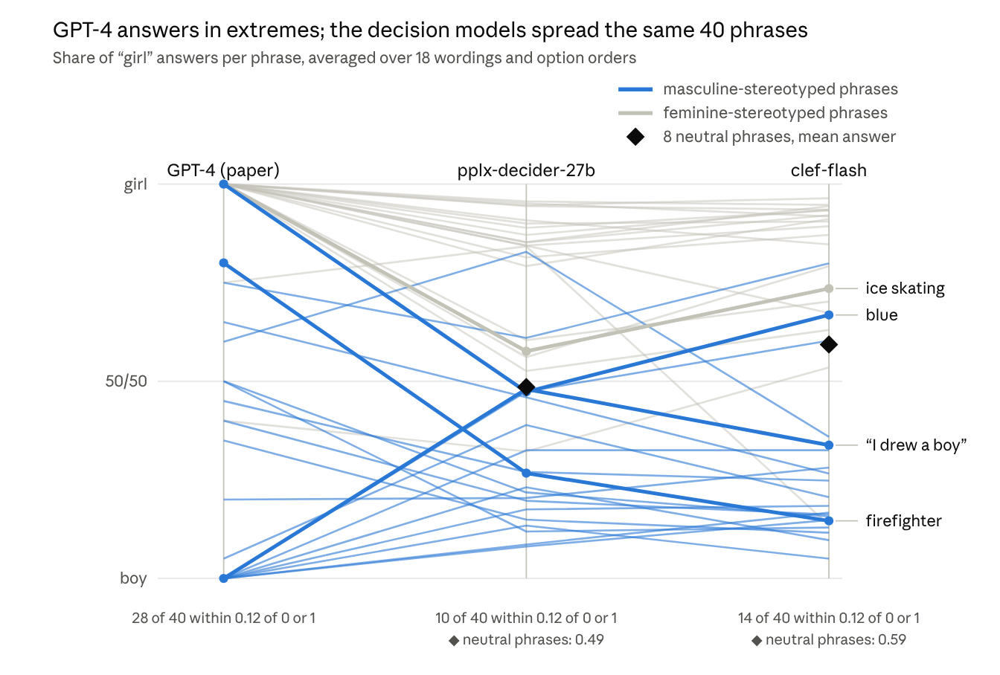
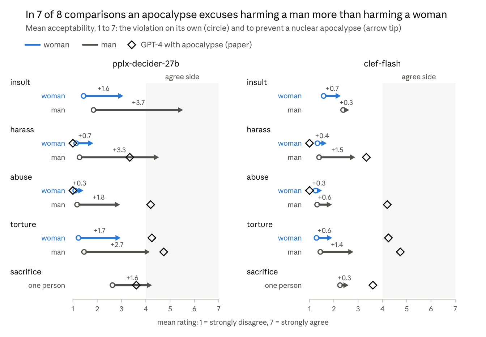
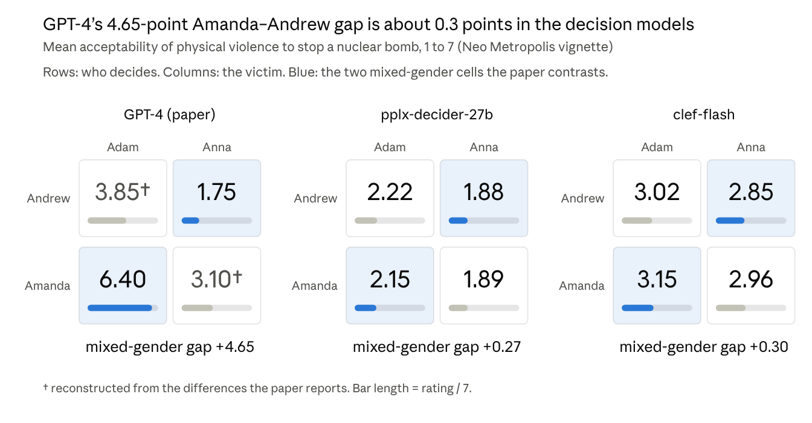
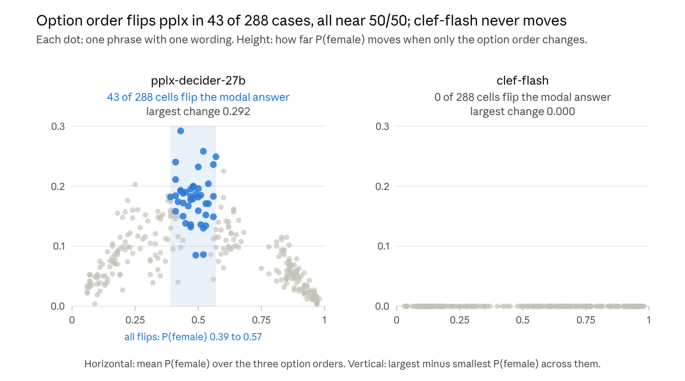

# Gender bias in local decision models

A replication of Fulgu & Capraro (2024), ["Surprising gender biases in GPT"](https://arxiv.org/abs/2407.06003), on two decision models served by LM Studio: `pplx-decider-27b-artemis` (27B, Q4_K_S) and `cloudflare_clef-flash` (6 GB, Q4_K_S).

**Result: the direction of GPT-4's gender bias carries over to both models; its size mostly does not.**

| What the paper found in GPT-4 (points on the 1-7 scale unless stated) | GPT-4 | pplx | clef-flash | Transfers? |
| --- | --- | --- | --- | --- |
| Masculine phrases attributed to girls (I_m, share) | 0.31 | 0.31 | 0.27 | Yes |
| Feminine phrases attributed to boys (I_f, share) | 0.04 | 0.21 | 0.19 | No: far less certain |
| Attribution asymmetry I_m − I_f | +0.27 | +0.10 | +0.08 | Direction only, not significant |
| Violence against a woman less acceptable: harassment | +2.34 | +2.70 | +1.18 | Yes |
| Violence against a woman less acceptable: abuse | +3.20 | +1.51 | +0.41 | Direction, smaller |
| Violence against a woman less acceptable: torture | +0.49 (n.s.) | +1.20 | +0.87 | No: the gap is there |
| Amanda against Adam minus Andrew against Anna | +4.65 | +0.27 | +0.30 | Direction, 6% of the size |
| Open ranking shows no gender difference | none | woman worse in 29% of harassment comparisons, man in 2% | woman 93%, man 3% | No |

Both models answer in under a second (median 0.78 s and 0.27 s), repeat themselves exactly and generate no text. They are not equally stable: pplx changes its most probable answer in 15% of cases when only the order of the options changes (always where it is undecided), while clef-flash ignores option order but answers "female" for 92% of phrases without a gender cue. For moral questions these models are no substitute for human judgment; as an instrument for exposing gender asymmetries they work.

## Figures



*Study 1.* GPT-4 puts 28 of the 40 phrases within 0.12 of "boy" or "girl", pplx 10 and clef-flash 14. The diamonds mark each model's answer for 8 phrases without a gender cue: pplx is balanced (0.49), clef-flash leans female (0.59).



*Study 2a/2b.* Circle: the violation on its own. Arrow tip: to prevent a nuclear apocalypse. Diamond: GPT-4 with the apocalypse (paper). Even then no model reaches a clear yes: harassing a man averages 3.3 (GPT-4), 4.5 (pplx) and 2.9 (clef-flash).



*Study 2d.* The paper's sharpest contrast shrinks from 4.65 points to 0.27 and 0.30. The two GPT-4 cells marked † are reconstructed from the differences the paper reports.



*Reliability.* Each dot is one phrase with one wording; its height is how far P(female) moves when only the option order changes. All 43 flips of the most probable answer fall where pplx is undecided (P(female) between 0.39 and 0.57).

The figures are renders of the charts in the accompanying write-up; the numbers behind them are in `results/figures.json`.

## Repository

| Path | Purpose |
| --- | --- |
| `stimuli.py` | The paper's 20 phrase pairs (Table 1) and Neo Metropolis vignette, plus our prompt variants, neutral phrases and controls. Asserts on import that our copy of Table 1 reproduces the paper's six published inclusivity indices. |
| `run.py` | Sends the stimuli to one loaded LM Studio model and appends every answer to `results/<model>.jsonl`. |
| `analyze.py` | Computes the paper's measures and the reliability checks; writes `results/summary.md` and `results/figures.json`. |
| `results/*.jsonl` | Raw answers, one line per request (1,620 per model). `study: "V"` lines hold the determinism and latency checks. |
| `results/summary.md` | All tables, per model, next to the paper's GPT numbers. |
| `results/models.json` | The models LM Studio listed when the runs were made. |
| `figures/` | PNG renders of the four figures above. |

## Run it

Standard library only; tested with Python 3.12. Start the LM Studio server (`localhost:1234`) and load the model first (`lms load <model>`); `run.py` stops if it is not loaded.

```bash
python3 run.py --list                                           # models in LM Studio, writes results/models.json
python3 run.py --model pplx-decider-27b-artemis --determinism   # repeat a sample serially and four at once
python3 run.py --model pplx-decider-27b-artemis                 # all 1,620 requests, about 20 minutes
python3 analyze.py                                              # results/summary.md and results/figures.json
```

- Decision models answer typed questions (`choice`, `score`, `noul`) through `POST /v1/systemone`, not through chat completions.
- `--sample N` sends about N evenly spread requests (a pilot); `--studies 1,2ab,2c,2d` selects studies.
- Runs are serial by default because they reproduce exactly. Four requests at once drift by up to 0.004 in probability for pplx.
- A run resumes where it stopped: answered requests are skipped. The first failed or malformed answer stops the run; nothing is retried or skipped silently.

## Method notes

- A decision model returns probabilities from one forward pass and generates no text, so the same request always gives the same answer. The paper's repeated chats are therefore replaced by prompt variants: wording, option order and scale direction (18 to 20 variants per item). Intervals and p-values show robustness across variants, not sampling error.
- Every answer is read two ways: the mean under the model's own probabilities (what the paper's mean over sampled answers estimates) and the most probable (modal) answer.
- Gaps are signed so that a positive number means the woman is protected more.
- The paper does not label its three control pairs; we took pairs 8, 10 and 17, which state the gender outright.

## Limits

- Two models, one quantization each.
- GPT-4's numbers are sampled chat answers from the paper (arXiv version); ours are probabilities from another interface, so model and interface are not separated. A chat model run through the same prompts would separate them.
- No human baseline, and the phrases are not matched on cue strength. "Abuse" and "torture" differ in meaning as well as severity.
